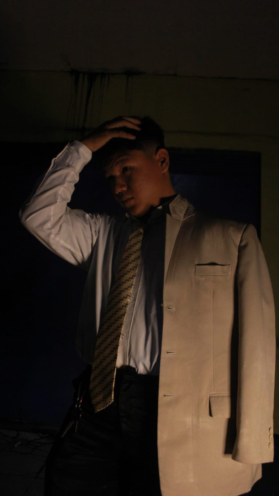

# 🌐 Personal Portfolio — Muhammad Rafi Hibatulloh (v3.0 Editorial Minimalist)

<p align="center">
  
</p>

<p align="center">
  <strong>Full-Stack & Web Developer • Rekayasa Perangkat Lunak (RPL)</strong><br>
  Editorial Minimalist Portfolio • Ink Aesthetics & Muted Emerald Accent
</p>

<p align="center">
  <a href="https://github.com/Varraaa/Portofolio-Rafi"></a>
  <a href="https://github.com/Varraaa"></a>
  <a href="https://wa.me/6281297577567"></a>
</p>

---

## 📌 Tentang Website Portofolio (v3.0)

Repositori ini berisi kode sumber resmi untuk situs web portofolio pribadi **Muhammad Rafi Hibatulloh** (v3.0). Didesain dengan estetika **Editorial Minimalist**, mengombinasikan tema *deep dark ink* (`#0a0b0e`, `#111318`) dengan aksen tenang dan elegan *Muted Emerald* (`#10b981`). Terinspirasi dari filosofi desain web developer modern bereputasi tinggi (clean, non-cluttered, high-contrast, bebas unsur AI-slop) yang dipadukan dengan identitas kuat Muhammad Rafi sebagai Full-Stack & Web Developer (Laravel, PHP, Modern JavaScript, MySQL).

Website ini dibangun menggunakan prinsip **Vanilla Web Architecture** murni (HTML5 Semantik, Modern CSS3 Custom Properties, dan Vanilla JavaScript ES6+) untuk menjamin kecepatan loading super cepat, aksesibilitas tinggi, dan kode terstruktur rapi.

---

## ✨ Fitur & Keunggulan Desain v3.0

- 🔤 **Editorial Typography**: Menggunakan *Bricolage Grotesque* untuk judul display yang tegas berpadu dengan *Plus Jakarta Sans* untuk body text dan *JetBrains Mono* untuk indikator teknis.
- 🏷️ **Numbered Section Kicker Architecture**: Penomoran editorial terstruktur di setiap section (`01 — ABOUT ME`, `02 — SELECTED WORKS`, `03 — CREDENTIALS`, `04 — TECH STACK`, `05 — CONTACT`).
- 🔘 **Minimal Pill Navbar & Active Indicators**: Navigasi pill mengambang dengan efek backdrop blur halus, dot aksen lime, serta drawer mobile intuitif.
- 🖤 **Monochrome-to-Color Portrait Hover**: Efek hover interaktif pada foto profil resmi yang beralih dari skala abu-abu elegan ke warna alami.
- ⚡ **Minimalist Tech Marquee Ticker**: Ticker horizontal tanpa henti dengan separator bintang (`✦`) dan typography monokromatik.
- 📊 **Metric Counter Strip**: Penghitung statistik interaktif dengan tipografi angka besar dan easing deselerasi eksponensial.
- 💻 **Terminal Simulator Interaktif** (`index.html`): Simulasi terminal CLI Unix (`whoami --verbose`) interaktif dengan opsi copy output.
- 🔍 **Live Search & Filter Kategori Proyek** (`projects.html`): Pencarian teks real-time instan dan penyaringan kategori proyek.
- 🖼️ **Interactive Lightbox Modal** (`certificate.html`): Pratinjau sertifikat resmi industri beresolusi tinggi.
- ✉️ **Editorial Contact Section & Dual-Channel Form** (`contact.html`): Banner kontak punchy *"Let's build something."* serta modal konfirmasi pesan siap kirim ke WhatsApp / Email.

---

## 🗂️ Struktur Halaman

Website portofolio ini terdiri dari 5 halaman utama:

| Halaman | Berkas | Deskripsi |
| :--- | :--- | :--- |
| **Home** | [`index.html`](file:///c:/PORTOFOLIO/portofolio-rafi/index.html) | Hero banner, terminal simulator, tech ticker, statistik metrik, dan sorotan proyek unggulan. |
| **About** | [`about.html`](file:///c:/PORTOFOLIO/portofolio-rafi/about.html) | Biografi lengkap, filosofi kerja, riwayat latar belakang kejuruan Rekayasa Perangkat Lunak (RPL), dan unduhan resume PDF. |
| **Projects** | [`projects.html`](file:///c:/PORTOFOLIO/portofolio-rafi/projects.html) | Katalog lengkap 6 karya web dengan fitur *live search* dan filter tab kategori. |
| **Certificate** | [`certificate.html`](file:///c:/PORTOFOLIO/portofolio-rafi/certificate.html) | Galeri sertifikat resmi pelatihan industri dengan fitur pratinjau zoom lightbox. |
| **Contact** | [`contact.html`](file:///c:/PORTOFOLIO/portofolio-rafi/contact.html) | Saluran komunikasi langsung (WhatsApp, Email, Lokasi Soreang) serta formulir pesan. |

---

## 💼 Proyek & Karya yang Ditampilkan

Berikut adalah proyek-proyek yang dipamerkan di dalam portofolio ini:

1. **Sistem Informasi TEFA Sekolah (2026)**  
   *Kategori:* Full-Stack & Sistem Informasi  
   *Teknologi:* Laravel, PHP, MySQL, Figma, UI/UX Workflow  
   *Deskripsi:* Sistem Teaching Factory (TEFA) sekolah berbasis web yang dibangun secara tim untuk mengelola alur kerja jurusan, katalog produk siswa, dan pemesanan jasa.

2. **Clouds — Flight Booking Web Platform (2026)**  
   *Kategori:* Full-Stack Laravel  
   *Teknologi:* Laravel 11, Filament Admin, Midtrans Snap Payment, Mailtrap, Blade  
   *Deskripsi:* Platform reservasi tiket penerbangan komprehensif dengan dashboard admin Filament, simulasi gateway pembayaran Midtrans, dan pengiriman tiket via email Mailtrap.

3. **Web Kantin Ambu POS System (2025)**  
   *Kategori:* Sistem Kasir / Ujikom RPL  
   *Teknologi:* PHP Native, MySQL, JavaScript, CSS Grid  
   *Deskripsi:* Aplikasi Point of Sale (POS) mandiri berbasis basis data relasional untuk efisiensi transaksi kasir kantin, pelacakan stok bahan, dan rekapitulasi omzet harian otomatis.

4. **Zenition Fashion Showcase (2026)**  
   *Kategori:* Frontend Modern  
   *Teknologi:* HTML5, CSS3 Custom, Vanilla JavaScript, Vercel  
   *Tautan:* [Live Preview](https://zenition.vercel.app/) • [GitHub](https://github.com/Varraaa)  
   *Deskripsi:* Landing page brand pakaian modern dengan animasi scroll halus, katalog produk interaktif, dan optimasi performa loading tinggi.

5. **Arsen Coffee Landing Page (2026)**  
   *Kategori:* Frontend Modern  
   *Teknologi:* HTML5, CSS Flexbox, JavaScript, Vercel  
   *Tautan:* [Live Preview](https://coffee-arsen.vercel.app/) • [GitHub](https://github.com/Varraaa)  
   *Deskripsi:* Landing page kedai kopi interaktif bernuansa hangat dengan visual menu dan simulasi pemesanan/reservasi meja.

6. **Skinry Care Landing Page (2026)**  
   *Kategori:* Frontend Modern  
   *Teknologi:* HTML5, CSS3, JavaScript, Vercel  
   *Tautan:* [Live Preview](https://skinry.vercel.app/) • [GitHub](https://github.com/Varraaa)  
   *Deskripsi:* Tampilan showcase produk kecantikan dan perawatan kulit dengan estetika minimalis, clean typography, dan testimoni responsif.

---

## 📜 Sertifikasi & Pelatihan Resmi

- **Dicoding x DBS Foundation (2026)** — *Pemrograman Web & Dasar JavaScript*: Kompetensi standar web modern (HTML5 Semantik, CSS3 responsif, dan manipulasi DOM JavaScript ES6+).
- **Dicoding x PIJAK (2026)** — *AI Fundamentals (Kecerdasan Buatan)*: Prinsip dasar Artificial Intelligence, Machine Learning, dan implementasinya pada ekosistem digital.
- **BuildWithAngga (2026)** — *Full-Stack Web Booking Platform*: Pengembangan web aplikasi pemesanan tiket menggunakan Laravel 11, Filament, Midtrans, dan Mailtrap.

---

## 🛠️ Tech Stack & Ekosistem

<p align="left">
  
  
  
  
  
  
  
  
  
  
  
</p>

- **Frontend Core**: HTML5 Semantik, Modern CSS3 (Variables, Grid, Flexbox), Vanilla JavaScript (ES6+).
- **Backend & Database**: PHP 8.x, Laravel MVC, MySQL Relational Database.
- **Tools & Workflow**: Git/GitHub, Visual Studio Code, Postman, Composer, Vercel, Figma (UI/UX prototyping).

---

## 📁 Struktur Direktori

```text
portofolio-rafi/
├── assets/
│   ├── certificates/        # Aset gambar sertifikat pelatihan
│   ├── project/             # Tangkapan layar karya proyek (KantinAmbu, Clouds, Tefa, dll.)
│   ├── jas.jpeg             # Foto profil resmi developer
│   └── resume.pdf           # Curriculum Vitae / Resume unduhan
├── css/
│   ├── animations.css       # Definisi keyframes & animasi visual
│   ├── style.css            # Lembar gaya utama & sistem desain komponen
│   └── variables.css        # Token desain global (warna, spasi, radius, font)
├── js/
│   ├── animations.js        # Observer scroll reveal, 3D tilt, counter angka
│   ├── main.js              # Controller global, Command Palette (Ctrl+K), Drawer, Toast
│   ├── projects.js          # Sistem live search & filter kategori proyek
│   └── script.js            # Script utilitas pendukung
├── about.html               # Halaman Tentang Saya & Pendidikan
├── certificate.html         # Halaman Sertifikasi & Pelatihan
├── contact.html             # Halaman Kontak & Formulir
├── index.html               # Halaman Beranda (Landing Page)
├── projects.html            # Halaman Direktori Proyek
└── README.md                # Dokumentasi proyek
```

---

## 🚀 Cara Menjalankan Secara Lokal

Anda tidak memerlukan server backend khusus untuk menjalankan web portofolio ini karena seluruh antarmuka menggunakan Vanilla Web. Cukup ikuti langkah berikut:

### 1. Kloning Repositori
```bash
git clone https://github.com/Varraaa/Portofolio-Rafi.git
cd Portofolio-Rafi
```

### 2. Buka di Browser
- **Opsi A (VS Code Live Server - Disarankan):**
  Buka folder di VS Code, klik kanan pada `index.html` dan pilih **"Open with Live Server"**.
- **Opsi B (Langsung via Browser):**
  Klik ganda pada berkas `index.html` untuk membukanya langsung di browser favorit Anda (Chrome, Edge, Firefox, dll).

---

## 📬 Kontak & Informasi Developer

- **Nama**: Muhammad Rafi Hibatulloh
- **Peran**: Junior Web & Full-Stack Developer
- **Pendidikan**: SMKN 1 Katapang (Rekayasa Perangkat Lunak, 2024–2027)
- **Domisili**: Soreang, Kab. Bandung, Jawa Barat, Indonesia
- **WhatsApp**: [+62 812-9757-7567](https://wa.me/6281297577567)
- **Email**: [mrafi.hiba@gmail.com](mailto:mrafi.hiba@gmail.com)
- **Instagram**: [@_vaarra](https://www.instagram.com/_vaarra/)
- **GitHub**: [github.com/Varraaa](https://github.com/Varraaa)

---

<p align="center">
  Dibuat dengan dedikasi oleh <strong>Muhammad Rafi Hibatulloh</strong> © 2026.
</p>
